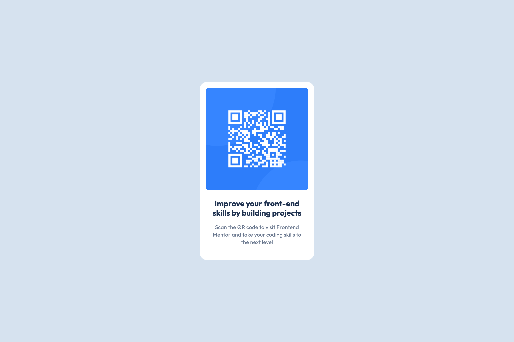

# Frontend Mentor - QR code component solution

This is a solution to the [QR code component challenge on Frontend Mentor](https://www.frontendmentor.io/challenges/qr-code-component-iux_sIO_H).

## Table of contents

- [Overview](#overview)
  - [Screenshot](#screenshot)
  - [Links](#links)
- [My process](#my-process)
  - [Built with](#built-with)
  - [What I learned](#what-i-learned)
  - [Continued development](#continued-development)
  - [Useful resources](#useful-resources)
  - [AI Collaboration](#ai-collaboration)
- [Author](#author)

## Overview

### Screenshot

<table>
  <tr>
    <td width="75%" align="center">
      
Desktop

      
    </td>
    <td width="25%" align="center">
      
Mobile

      
    </td>
  </tr>
</table>

### Links

- Solution URL: [GitHub Repository](https://github.com/the-firstrong/qr-code-component)
- Live Site URL: [QR Code Component](https://the-firstrong.github.io/qr-code-component/)

## My process

### Built with

- Semantic HTML5 markup
- Flexbox

### What I learned

- Using HTML and CSS to structure and style a webpage.

### Continued development

- Improve my responsive disign skills.

### Useful resources

- [freeCodeCamp](https://www.freecodecamp.org/) - This helped me learn and practice HTML and CSS.

### AI Collaboration

- **ChatGPT:** Used for learning HTML and CSS, debugging and understading solutions.
- **GitHub Copilot:** Used for code suggestion and autocomplete.

## Author

- GitHub - [@the-firstrong](https://github.com/the-firstrong)
- Frontend Mentor - [@the-firstrong](https://www.frontendmentor.io/profile/the-firstrong)